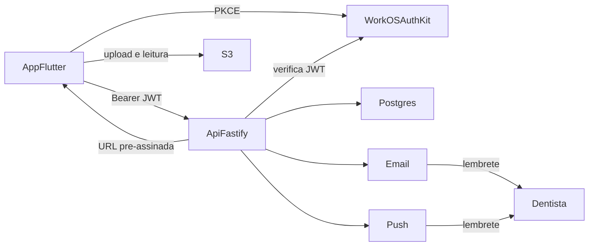
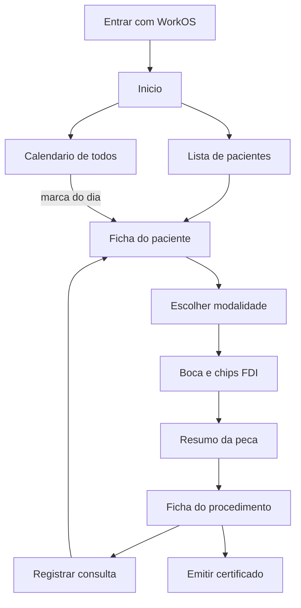
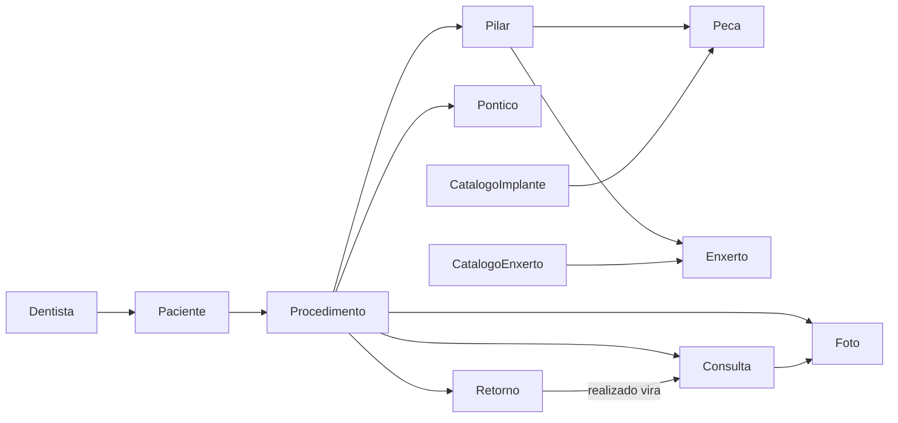

# Implate Flow

Prontuário na nuvem para um implantodontista acompanhar implantes, enxertos, retornos e a procedência de cada peça. Este repositório é o aplicativo Flutter para Android e iOS. A API e a versão web ficam em outros repositórios.

O dentista entra com a própria conta e vê os dados em mais de um aparelho. O paciente não acessa o sistema. Clínica com equipe e SSO ficam para a versão seguinte.

## Problema

O controle do implante costuma ficar espalhado entre agenda, fotos da câmera e anotações. O dentista perde a linha do tempo (cirurgia, osseointegração, prótese, manutenção) e esquece o retorno.

O app responde o que foi feito, em qual dente, com qual peça, em que fase está o tratamento e quando o paciente volta, e emite o certificado de procedência.

## Arquitetura

Flutter no celular. API em Node.js (Fastify). PostgreSQL para o prontuário e os catálogos. Fotos e PDF no S3, com URL pré-assinada. Login do dentista pelo WorkOS AuthKit. Banco, bucket e backup ficam em região no Brasil.

O app abre o AuthKit no navegador do sistema com PKCE e um client ID público. Não há chave secreta no celular. A API verifica o access token (JWKS) em toda rota. O refresh token fica no armazenamento seguro do aparelho.

WorkOS guarda só a conta do dentista (e-mail, nome e id). Paciente, dente, peça, enxerto, foto e certificado não passam por ele.

## Fluxo do app

1. O dentista entra e cadastra o paciente.
2. Escolhe a modalidade e toca os dentes na boca aberta. Os números FDI aparecem em chips abaixo da imagem.
3. No resumo, preenche a cirurgia e o rastreio de cada pilar, confirma sutura em 7 dias e o retorno longo, e ajusta o lembrete de cada data.
4. Na ficha do procedimento, anexa fotos e emite o certificado.
5. No dia do retorno, recebe e-mail e push no horário configurado. Abre o retorno, marca como realizado e grava a consulta.
6. Na ficha do paciente, consulta o resumo dos implantes, os próximos encontros e o histórico. No calendário, vê as datas de todos os pacientes no mesmo mês.

## Primeira versão

- Conta do dentista (e-mail, senha e MFA).
- Pacientes, com vários procedimentos no mesmo dente ao longo do tempo.
- Quatro modalidades na boca: implante unitário, ponte fixa, protocolo e enxerto sozinho.
- Rastreio da peça e do enxerto. Fabricante e modelo vêm de catálogos no banco.
- Certificado de procedência em PDF, um por procedimento.
- Perfil com nome completo e CRO/UF.
- Fotos do procedimento e da consulta.
- Ficha do paciente com resumo dos implantes, histórico e próximos encontros.
- Calendário geral com cirurgias, consultas e retornos de todos os pacientes.
- Lembrete do dia do retorno por e-mail e push, configurável.
- Exportação do prontuário para o dentista entregar ao paciente.

Ficam fora desta versão: portal do paciente, financeiro, estoque, prescrição, tomografia, app web, clínica com equipe, SSO e WhatsApp.

## Modalidades

A boca mostra as 32 posições permanentes, numeração FDI, arcada superior em cima. A modalidade é escolhida antes do toque. A tela da boca não leva data, status nem rastreio. Os chips ficam abaixo da imagem, na ordem 18–11, 21–28, 48–41, 31–38. Remover um chip desmarca o dente.

| Modalidade | Seleção | O que é gravado |
| --- | --- | --- |
| Implante unitário | Qualquer dente | Um procedimento por dente |
| Ponte fixa | Trecho contínuo de uma arcada. Extremidades começam como pilares e o meio como pôntico; o dentista troca no chip | Uma ponte. Pôntico não tem peça |
| Protocolo | Arcada superior ou inferior, no mínimo duas posições de implante | Um protocolo da arcada |
| Enxerto sozinho | Igual ao unitário, sem papel de pilar | Um procedimento de enxerto por dente |

Enxerto junto da peça é um interruptor em cada pilar, no resumo. Não é uma quinta modalidade.

## Resumo da peça

Um bloco por pilar, ou por dente no enxerto sozinho. Pônticos aparecem só como lista.

- Grupo Implante, em cada pilar: fabricante, modelo, tamanho (diâmetro e comprimento), número de série, lote, fabricação, validade e registro ANVISA.
- Grupo Enxerto, no enxerto sozinho ou quando o pilar está marcado: origem biomaterial ou autógeno. No biomaterial, fabricante, modelo, tamanho ou volume, lote, série, fabricação, validade e registro ANVISA. No autógeno, a região doadora. Dá para acrescentar outro enxerto no mesmo dente.
- Fabricante e modelo são listas do catálogo daquele grupo. Modelo só habilita depois do fabricante. A lista de implante não entra no enxerto.
- Série, lote, tamanho, fabricação e validade são de cada peça e de cada enxerto.
- O rastreio pode ficar em branco e ser completado depois. O certificado só sai com os campos obrigatórios.

Catálogo inicial de implantes: Neodent, Straumann e Nobel Biocare, com os modelos de cada um. Catálogo de enxertos: biomateriais como Geistlich Bio-Oss. O dentista não cadastra outro nome. Incluir ou aposentar item é carga de dados.

## Prazos e retornos

Ao salvar, o app propõe sutura em 7 dias e um retorno longo. O dentista confirma ou altera as datas.

| Situação | Espera longa | Motivo |
| --- | --- | --- |
| Peça sem enxerto | 3 meses | Osseointegração, instalação da ponte ou instalação do protocolo |
| Algum pilar com enxerto | 6 meses | A espera do conjunto inteiro, na ponte e no protocolo |
| Enxerto sozinho | 6 meses | Instalar o implante naquele dente |

Cada retorno guarda se avisa no dia e a que horas. O padrão do perfil é ligado, às 8h, fuso de Brasília. Na confirmação, o dentista desliga aquele compromisso ou escolhe outro horário. E-mail e push saem nesse horário. Se o retorno seguir agendado no dia seguinte, sai um aviso de atraso, uma vez.

O texto do lembrete leva nome do paciente, dente ou arcada e motivo. Série, lote, foto e telefone do paciente não entram. O paciente não recebe mensagem. WhatsApp, numa versão seguinte, repete o mesmo texto no número do dentista.

## Status

Enxerto sozinho: Planejado, Realizado, Em maturação, Pronto para implante, Intercorrência.

Unitário, ponte e protocolo: Planejado, Instalado, Em osseointegração, Reabertura, Prótese, Concluído, Manutenção, Intercorrência. Na ponte e no protocolo o status é o da reabilitação.

A consulta pode mudar o status. Realizar um retorno pode gerar uma consulta.

## Consulta

Na ficha do paciente:

- Resumo dos implantes: uma linha por pilar, com dente, modalidade, fabricante, modelo e status. Pôntico e enxerto sozinho ficam de fora.
- Próximos encontros: retornos agendados, do mais perto ao mais distante.
- Histórico: cirurgias e consultas, da mais recente à mais antiga. Abrir um item leva à ficha do procedimento.

O calendário junta, num mês, as datas de todos os pacientes: cirurgia, consulta e retorno. Cada marca mostra o nome e o motivo. Vários pacientes no mesmo dia aparecem juntos. Tocar a marca abre aquele ponto. Retorno atrasado continua no dia em que estava marcado.

## Certificado de procedência

Um PDF por procedimento, gerado pela API e gravado no S3. Na ponte e no protocolo, um PDF lista todos os pilares. Pôntico entra só como número.

Obrigatórios sempre: CRO/UF, paciente, data da cirurgia e dentes. Em cada pilar: fabricante, modelo, tamanho, número de série, fabricação e validade. No enxerto de biomaterial: fabricante, modelo, lote e validade. No autógeno: região doadora. Se faltar campo, o app aponta o campo e não gera o arquivo.

O PDF traz profissional, cirurgia, implante, enxerto e a data de emissão. Telefone, fotos, observação e status ficam de fora. Emitir de novo gera outro PDF se os dados tiverem sido corrigidos.

## Modelo

Paciente: nome, telefone, data de nascimento e observação. Nome e nascimento entram no certificado. Menor de 18 anos leva o nome do responsável legal. Telefone não entra no certificado nem em mensagem.

## LGPD

Dado de saúde (paciente, dente, cirurgia, peça, enxerto, foto e certificado) serve ao prontuário e ao certificado. Não entra em marketing, treino de modelo, pesquisa nem venda.

- O dentista é o controlador. O Implate Flow é o operador. O provedor de nuvem no Brasil é suboperador do prontuário. WorkOS, e-mail e push são suboperadores só da conta e do lembrete.
- Base: tutela da saúde no procedimento do dentista, e o dever legal de guardar o prontuário.
- Prontuário, foto e PDF ficam no Brasil, criptografados em repouso e em trânsito. A URL da imagem expira e só sai para o dentista dono. Log não grava nome de paciente, série, lote nem conteúdo de foto.
- O dentista corrige o cadastro e exporta uma cópia, com fotos e certificados, para entregar ao paciente.
- A Lei nº 13.787/2018 permite eliminar o prontuário só depois de 20 anos do último registro. Cada consulta, procedimento ou certificado reinicia a contagem. A eliminação apaga também o objeto no S3.
- Acesso indevido, vazamento ou perda é registrado e comunicado ao dentista, para ele avisar a ANPD e o paciente quando a lei exigir.

## Versão seguinte

Clínica como Organization do WorkOS. A conta individual vira uma clínica de um membro, sem recriar pacientes.

- SSO com Google Workspace, Microsoft Entra ou SAML.
- Convite de dentistas e secretárias.
- Papéis: administrador, dentista e secretária. A secretária cuida de pacientes, agenda e retornos. Implante, status clínico, certificado e exclusão de foto ficam com o dentista.
- O prontuário passa a ser da organização. O autor de cada registro permanece para auditoria.
- WhatsApp para o dentista, com o mesmo texto do lembrete e opt-in no perfil. O telefone do paciente continua sem uso.

Diretório sincronizado em massa e portal do paciente ficam para depois dessa versão.
